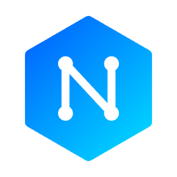

<div align="center">



# Nexus TM

**See everything. Control anything. For you.**

The installation packages of Nexus TM for Windows 11, on x64 and Arm64.

[nexustm.ai](https://nexustm.ai) · [Releases](../../releases) · [Channels](#channels) ·
[How updates work](#how-updates-work) · [Feedback](#feedback)

</div>

## What this repository is

This repository holds **the packages and nothing else**. Every version of Nexus TM is a release here, with its
installer, its portable ZIP and a `SHA256SUMS` file. The source code is private. Nexus TM is free to use, including
at work.

There is nothing to build here. Issues, the wiki, discussions and pull requests are switched off on purpose: reports
reach the developer from inside Nexus TM, where they can carry what is needed to understand them (see
[Feedback](#feedback)).

## What Nexus TM is

A task manager for Windows 11 that goes much deeper than the one built into Windows:

- **real-time monitoring** of processes, services, network connections, GPUs and NPUs;
- **a full inventory** of the machine, with disk health;
- **automation rules**: *when* something happens, *if* a condition holds, *then* act;
- **security checks**, and **system changes you can undo**, with a log of what changed and when;
- **benchmarks** compared with this machine's own history rather than with a leaderboard;
- **widgets**, on the Windows 11 board and in an on-screen display;
- **a long history** of the machine, with hour-by-hour patterns;
- **an AI assistant** that answers by reading the computer, with a local model or with a provider you choose.

It is built **local-first**. Everything works offline. When the network is there, Nexus TM uses it only for things
that say nothing about you, and anything that would say something about you waits for your gesture.
**There is no telemetry.**

## Channels

| Channel | For | What it carries |
| --- | --- | --- |
| **Stable** | everyone | Final versions (`0.9.0`), signed, after at least seven days on Beta with no blocking report. *Empty until the public release.* |
| **Beta** | family & friends who test Nexus TM | Builds already tried on Dev (`0.9.0-beta.2`). |
| **Dev** | the developer | Every build worth trying (`0.9.0-dev.7`). |

Every build has a **build number** that is shared by all channels and only grows: *newer* always means a higher
build number, never a label. A build moves from Dev to Beta to Stable **with the same bytes**: a channel is a pointer
to a build, and promoting a build never rebuilds it. Releases that are not on Stable are marked **pre-release**.

Releases in this repository are **immutable**: once published, a package can never be replaced. A build with a
serious problem is not deleted; it is **retired**, the channels point to a newer build that fixes it, and its release
notes say why.

## How updates work

From version 0.9, Nexus TM keeps itself up to date through `update.nexustm.ai`:

1. **Once a day**, when the network is there, or when you press *Check now*, Nexus TM asks
   `https://update.nexustm.ai/v1/<channel>.json` what is new on your channel. The request carries **nothing about
   you**: not your version, not an installation ID. The server sees your address, as every website does.
2. The answer is a **manifest signed** with a key that never leaves the developer's laptop (ECDSA P-256); the public
   half is compiled into Nexus TM. Before using anything, Nexus TM checks:
   - the **signature** of the manifest;
   - its **sequence number**, which can never go back: an old manifest, even a genuine one, is refused;
   - the **build number**, which must be higher than the one installed;
   - the **SHA-256** of the downloaded package, against the manifest;
   - the **code signature**, on every signed build and always on Stable.
3. The package comes **from this repository**: `update.nexustm.ai/scarica/<version>/<file>` simply redirects to the
   release here.
4. If any check fails, **nothing is installed**, and Nexus TM tells you which check failed.

Changing channel never goes back by itself: moving to a more stable channel, you stay on your build until that channel
has a newer one.

> ⚠️ **Unsigned builds.** Until the code-signing certificate is in place, Dev and Beta builds are **not signed**, and
> they say so in their release notes and inside Nexus TM. Windows SmartScreen will ask you to confirm before running
> them. Stable builds are always signed.

### Verifying a download yourself

Every release has a `SHA256SUMS` file. In PowerShell:

```powershell
Get-FileHash .\NexusTM-0.9.0-x64-setup.exe -Algorithm SHA256
```

The hash must match the line for that file in `SHA256SUMS`.

## Feedback

From version 0.9, the **Feedback** page in Nexus TM (also at <kbd>Ctrl</kbd>+<kbd>Shift</kbd>+<kbd>F</kbd>) lets you
report a bug, ask for a feature or point at something in the interface. Nexus TM prepares a package with what you
wrote, a picture of **its own window** (covered by presentation mode, unless you choose otherwise), an **anonymous**
description of the computer, and the last actions taken in Nexus TM.

- **You see everything that goes out**, and every part has its own switch.
- The package is **encrypted inside Nexus TM**, with a key that only the developer holds, and sent to
  `feedback.nexustm.ai`. The server stores bytes it cannot read, and does not keep your address with the report.
- **Nothing is sent without your gesture.** Reporting crashes automatically is a setting, and it is off.
- When the channel cannot be reached, Nexus TM offers to send the package by email, to
  [info@nexustm.ai](mailto:info@nexustm.ai).

Until 0.9, write to [info@nexustm.ai](mailto:info@nexustm.ai).

## License

Nexus TM is **free to use**, on as many computers as you like, at home or at work. You may copy the installable
program as it is, to install it elsewhere. You may not sell it, include it in something that is sold, or redistribute
a modified version. **This is not open-source software**: free and open are two different things, and only the first
applies here. FABRIC, the part that manages several computers from one, is free on one computer and needs a
commercial license beyond that. The full license comes with every release.

"Nexus TM" and the Hex Badge logo are trademarks of Andrea D'Orio.

## Credits

Made in Torino by Andrea D'Orio.

IP Geolocation by [DB-IP](https://db-ip.com), under the Creative Commons Attribution 4.0 license.
